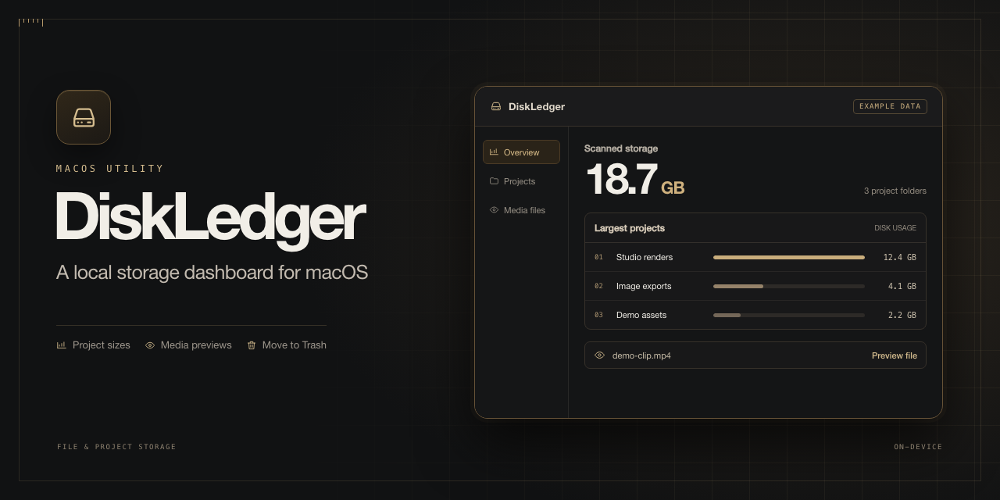

# DiskLedger



DiskLedger shows how much space ChatGPT and Codex project files use on your Mac. The dashboard currently uses Simplified Chinese. See the largest projects first, preview individual files, and move selected files to the macOS Trash.

## Run on macOS

DiskLedger requires macOS 15 or later and Python 3.9 or later. It uses Python’s standard library.

Clone this repository or use **Code → Download ZIP** on GitHub and extract it. Open **Launch DiskLedger.command** from Finder, or run this from the repository folder in Terminal:

```sh
python3 -B server.py
```

The dashboard opens in your browser at [127.0.0.1:8765](http://127.0.0.1:8765/). Press **Ctrl+C** in Terminal to stop it.

## Review files and reclaim space

- See disk usage ranked by project. Expand a source to find the tasks, projects, and export folders behind its total.
- Search by filename, path, or project name. Sort the file list by size or modification date.
- Click an image or video to preview it. You can play and seek videos supported by your browser. For formats such as ProRes, use the option in the preview window to open the file in a macOS app.
- Tick the files you want to remove, then click **删除选中文件** (Delete selected files) in the toolbar. Confirm the list to move those files to Trash. Restore them from Finder if needed. macOS reclaims the space after you empty Trash.

## Scan scope

The default scan checks for local ChatGPT projects, generated images, visualizations, and dated Codex task exports. It discovers `output`, `outputs`, `exports`, and `deliverables` directories in projects registered with the desktop app. When available, the local index supplies project names and task titles.

Use the folder manager to add a project directory under your home folder or on an external volume. Removing a directory from the scan removes only the setting. The scan skips hidden folders, common dependency directories, macOS packages, and symbolic links. Git-tracked files are read-only in the dashboard.

The file list shows up to 5,000 files with an apparent size or allocated size of at least 1 MiB. Disk usage is estimated from allocated blocks. APFS clones and shared blocks can make the actual space reclaimed differ from the estimate.

The app listens on the Mac’s loopback interface. Scans, previews, and folder settings stay on your Mac.

## 中文

DiskLedger 是一个 macOS 本地磁盘管理工具。可以按项目查看 ChatGPT 和 Codex 的文件占用，点击图片或视频预览，并把选中的文件移到废纸篓。双击 **Launch DiskLedger.command** 启动。
